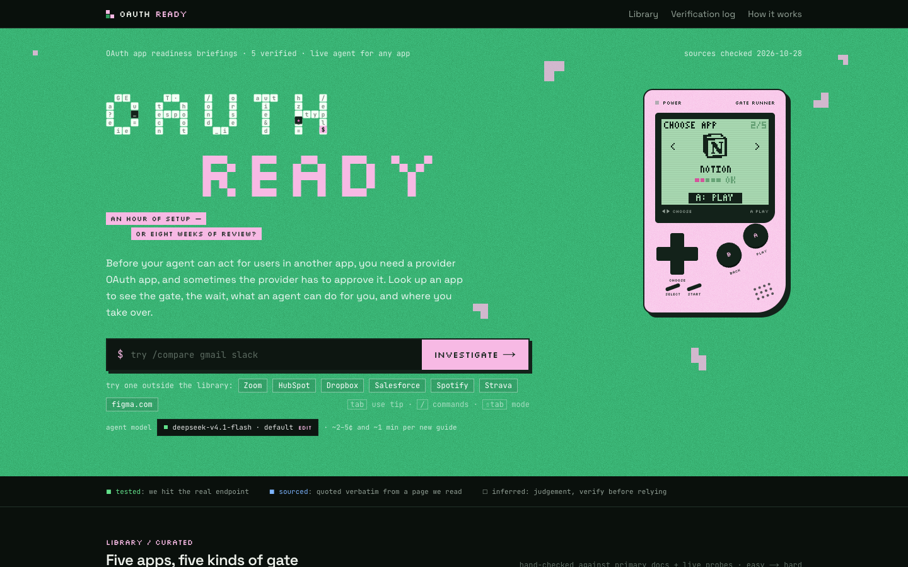
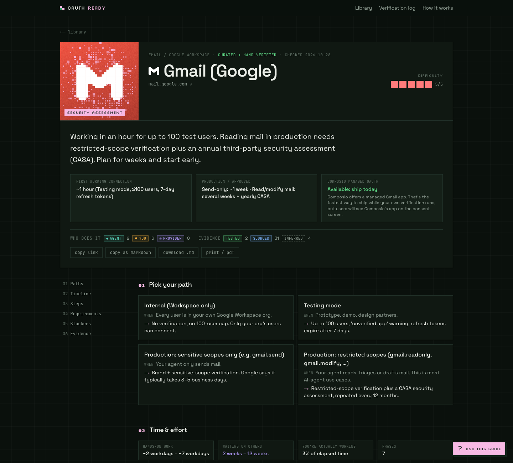
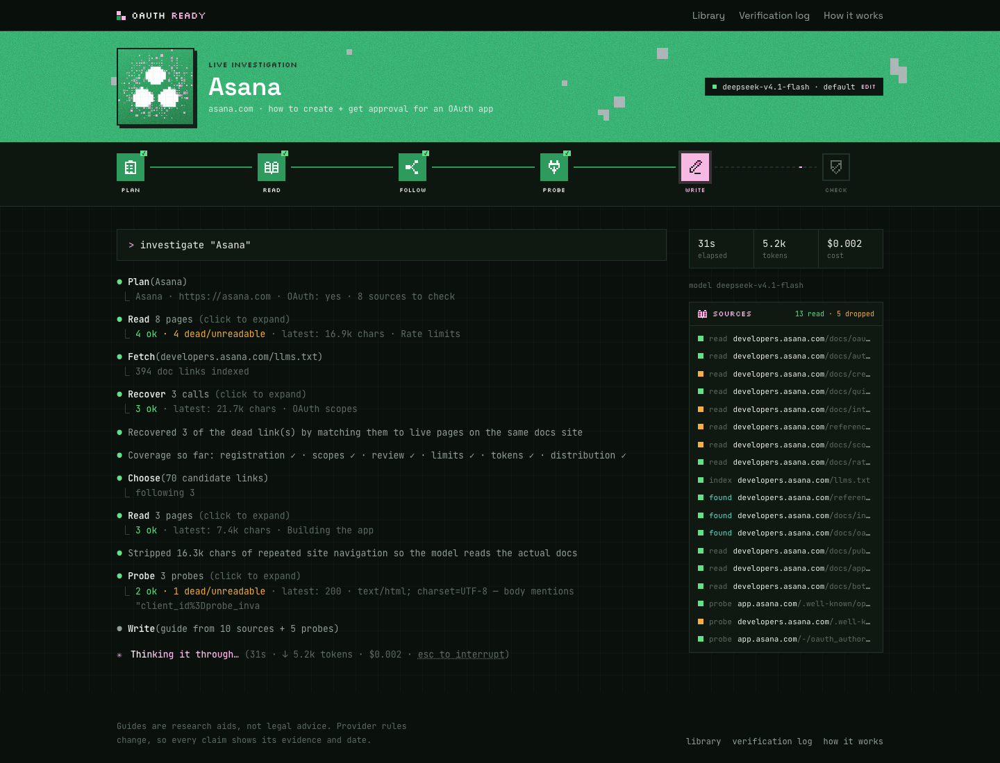
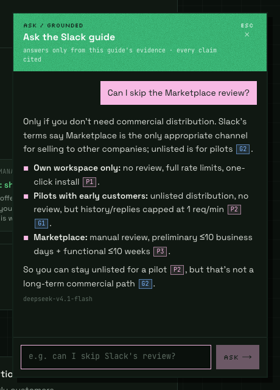
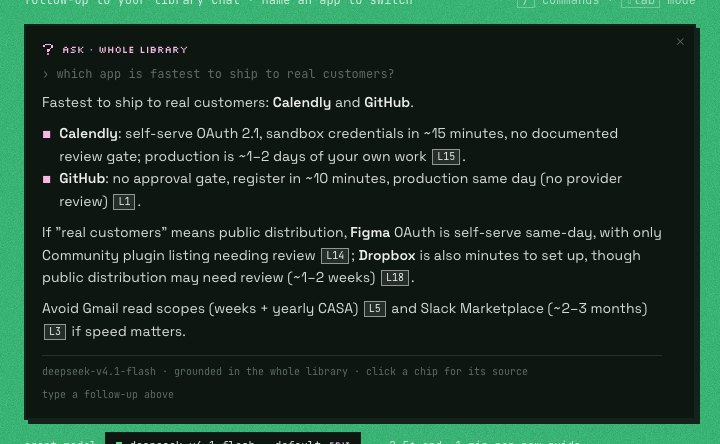
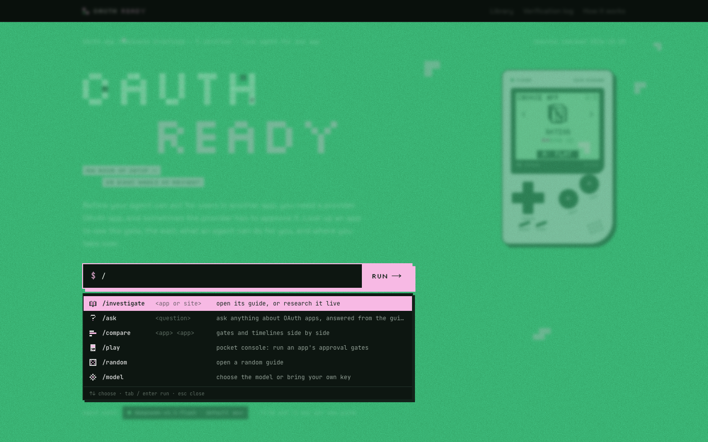
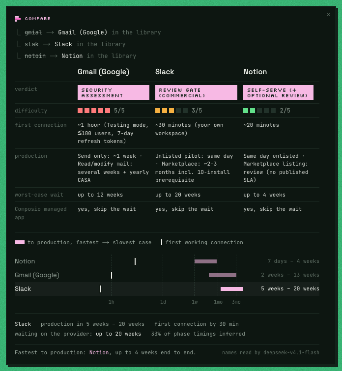
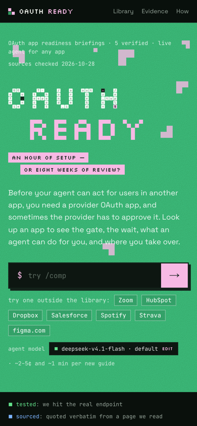
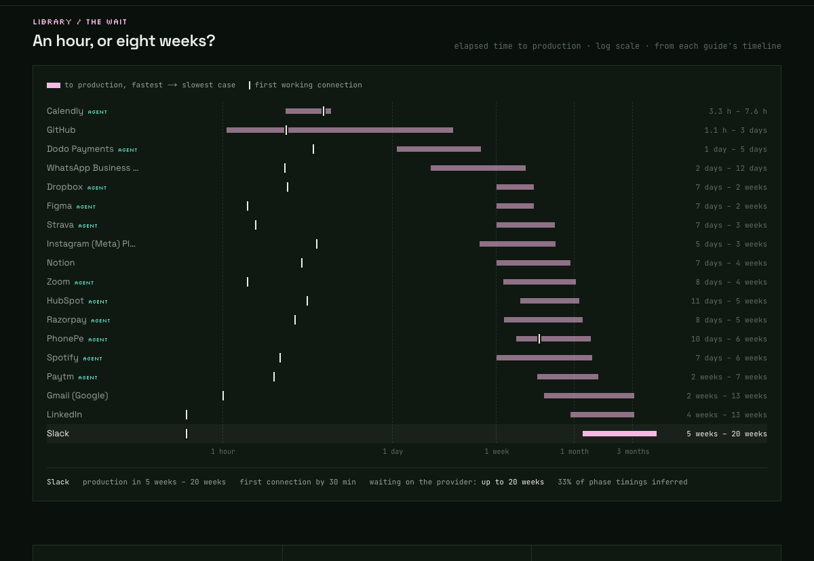
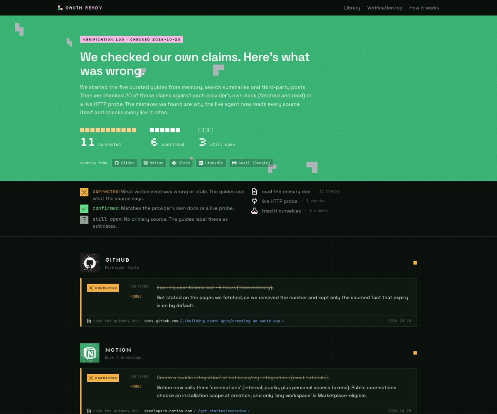

<p align="center">
  
</p>

<h1 align="center">OAuth Ready</h1>

<p align="center">
  <b>Will this integration take an hour, or eight weeks of review?</b><br />
  Evidence-backed guides for creating and getting approval for provider OAuth apps,<br />
  plus a live agent that researches any app in about a minute.
</p>

<p align="center">
  <a href="https://oauth-ready-xi.vercel.app"><b>▶ Live: oauth-ready-xi.vercel.app</b></a>
</p>

<p align="center">
  <a href="#how-it-helps">How it helps</a> ·
  <a href="#tour">Tour</a> ·
  <a href="#run-it">Run it</a> ·
  <a href="#how-the-live-agent-works">How the agent works</a> ·
  <a href="#key-decisions">Key decisions</a>
</p>

<p align="center">
  <a href="https://vercel.com/new/clone?repository-url=https%3A%2F%2Fgithub.com%2Fsrivtx%2Foauth-ready&env=OPENCODE_API_KEY&envDescription=OpenCode%20Zen%20key%20for%20the%20default%20model&envLink=https%3A%2F%2Fopencode.ai%2Fzen"></a>
</p>



## The problem

Before an AI agent can act for a user inside Gmail, Slack or LinkedIn, its developer needs a **provider OAuth app**: a client ID and secret, redirect URLs and scopes, registered with that provider. Registering one takes about ten minutes almost everywhere. What burns teams is what comes after:

- **Gmail:** reading mail needs restricted-scope verification *and* a yearly third-party security assessment (CASA). That's weeks.
- **Slack:** selling to other companies needs 10 active installs before you can even apply, then up to ~10 weeks of review.
- **LinkedIn:** company pages and analytics need partner approval, and a rejection can burn the app.

The rules live across dozens of doc pages, change without notice, and blog posts about them are often wrong. Teams find the gate after they've built the integration.

## How it helps

OAuth Ready turns "how do I connect to X?" into a one-page briefing you can read in two minutes and share with your team.

| You want to… | OAuth Ready gives you |
|---|---|
| **Scope an integration before building it** | A verdict (difficulty 1–5 and a one-line headline) and a timeline split into *your hands-on work* and *waiting on the provider* |
| **Ship this week, not next quarter** | The paths around the wait: test modes, unlisted distribution, internal-only apps, and whether Composio has a managed OAuth app you can use today |
| **Split work between your agent and you** | Every step has an owner. The agent drafts scope justifications, demo scripts and pre-filled app registrations; you handle logins, legal identity and recordings |
| **Know what to trust** | Every claim is tagged **tested** (we hit the endpoint), **sourced** (quoted verbatim from a page we read) or **inferred** (judgement, verify first) |
| **Handle an app nobody has written up** | Type its name. The live agent reads the provider's docs, probes its endpoints and writes a guide in about a minute, for about 2–5¢ |
| **Get a straight answer** | Ask a question in plain English and get an answer that cites the exact facts it used |

**A worked example.** Your agent needs to triage a user's inbox. Search "gmail" and the guide tells you:

1. You can have a working connection in **about an hour** in Testing mode (up to 100 users, refresh tokens expire every 7 days).
2. `gmail.readonly` is a **restricted** scope, so production means verification **plus CASA, repeated every 12 months**: plan for weeks.
3. If you only *send* mail, `gmail.send` is merely sensitive: **about a week**.
4. Composio offers a **managed Gmail app**, so you can ship today while your own verification runs.
5. Your agent can draft the scope justification and the demo-video script; you record the video and verify the domain.

That's the difference between promising a launch date and discovering a two-month gate in week three.

## Tour

### A guide

Verdict and difficulty up top, then the paths, a timeline of who does what, every step, requirements, blockers, and the sources behind each claim. Copy it as Markdown, download it, or print it.



### The live agent

Type any app. You watch the agent plan, read the docs (including the site's `llms.txt` index), recover dead links, check topic coverage, strip site navigation, probe the real OAuth endpoints, write, then quote-check its own claims, with elapsed time, tokens and cost as it goes.



### Ask, with citations

Every guide has a chat that answers only from that guide's facts. Each sentence cites the facts it used as chips coloured by evidence level; click one to see the fact and its verbatim quote. From the home page you can ask across the whole library and keep asking follow-ups. Questions the facts don't cover get a short answer marked *general knowledge*, and off-topic questions are politely declined.

<table>
  <tr>
    <td width="40%"></td>
    <td></td>
  </tr>
</table>

### Commands in the search box

Type `/` for a command menu. When the box is empty it types out a tip; press `Tab` to use it.



| Command | What it does |
|---|---|
| `/investigate <app or site>` | The default. Opens a library guide, or runs the live agent |
| `/ask <question>` | Ask mode. Name one app to use its guide; name several, or none, to ask across the library. Follow-ups keep the conversation |
| `/compare <app> <app> [app]` | Verdict, difficulty, timelines, worst-case wait and managed-app status side by side. Instant, no model call |
| `/play` | Opens the pocket console: pick an app, jump its approval gates, win to open its guide |
| `/random` | Opens a random curated guide |
| `/model` | Choose the model, or bring your own key |

`↑` `↓` choose · `Tab` / `Enter` run · `Shift+Tab` cycles modes · `Backspace` on an empty box leaves a mode.

<table>
  <tr>
    <td width="62%"></td>
    <td></td>
  </tr>
</table>

### An hour, or eight weeks?

Every guide's elapsed time to production on one log-scale axis, from its phase timeline: fastest to slowest case, with a tick for the first working connection. Hover a row for the breakdown, including how much of the timing is estimated.



### The verification log

We checked our own starting assumptions against primary sources. `/evidence` shows what we believed, what the source actually said, how we checked, and what's still open.



## Evidence levels

| Tag | Meaning | How it's enforced |
|---|---|---|
| **tested** | We sent a real request and saw the response | Endpoint probes run during research |
| **sourced** | Quoted verbatim from a page we read | Code checks the quote really occurs in that page's text; failures are downgraded |
| **inferred** | Judgement or estimate | Shown with a dashed tag; the chat says "estimate" when it relies on one |

## Run it

Requires Node 20+.

```bash
npm install
cp .env.example .env.local    # add OPENCODE_API_KEY (default model) and/or GEMINI_API_KEY (free fallback)
npm run dev                   # http://localhost:3000
```

`npm run build && npm start` for a production build, `npm run lint` to lint.

### Environment

| Variable | Needed | Purpose |
|---|---|---|
| `OPENCODE_API_KEY` | yes (or Gemini) | Default model: DeepSeek V4.1 Flash via [OpenCode Zen](https://opencode.ai/zen) |
| `GEMINI_API_KEY` | optional | Free-tier fallback (small daily quota) |
| `BLOB_READ_WRITE_TOKEN` | in production | Persists agent-generated guides in Vercel Blob. Without it they're saved to `./data/generated` |
| `JINA_API_KEY` | optional | Higher rate limits for the page reader |
| `OPENCODE_MODELS_SMART`, `OPENCODE_MODELS_FAST` | optional | Comma-separated model fallback chains |
| `GENERATE_LIMIT_PER_HOUR` | optional | Fresh agent runs per IP on the shared key (default 8) |
| `ASK_LIMIT_PER_HOUR` | optional | Questions per IP on the shared key (default 40) |

### Deploy

1. Import the repo on Vercel (or use the button at the top) and set `OPENCODE_API_KEY`.
2. Add a Blob store (Storage → Blob → connect to the project) so `BLOB_READ_WRITE_TOKEN` is set and generated guides persist across deploys.
3. The agent route allows up to 300 s (`maxDuration`); a typical run takes about a minute.

## How the live agent works

`src/lib/agent/run.ts`. Each step streams to the UI as NDJSON.

| Step | What happens |
|---|---|
| Plan | The model (reasoning off) identifies the app and proposes 5–8 official doc URLs |
| Read | Each URL is fetched, plus the docs host's `llms.txt` index if it has one. 404s, JS-only shells, login pages and duplicates are dropped and shown. **Dead links are recovered** by matching them to the live page on the same host whose path shares the most words |
| Follow | Code measures **topic coverage** (registration, scopes, review, limits, tokens, distribution). Links that fill a missing topic rank first, and the model is told which gaps to fill when it picks up to 7 more |
| Clean | Lines repeated across a site's pages (menus, footers) are stripped, so the writer and the quote checker read the docs, not the chrome. On Spotify this removed ~140k characters and raised verified quotes from 10/23 to 31/33 |
| Probe | Real GETs: `/.well-known/openid-configuration`, then the authorize endpoint with a fake `client_id`, to see whether it exists and how it fails |
| Write | The model writes the guide from numbered sources only, constrained by a JSON schema with enums |
| Check | Code validates citation ids, then a **quote check**: every `sourced` claim needs a verbatim supporting sentence that code confirms is really in the page. Failures are downgraded to `inferred`. Links are re-checked, and each page reports what it backed |

## Key decisions

1. **Lead with the gate, not the steps.** Registration is easy everywhere; the approval gates are what slip launches. Each guide opens with the verdict and a timeline that separates *your work* from *waiting*.
2. **Show ways around the wait.** Test modes, unlisted distribution, and Composio's managed OAuth apps (checked against the [managed-auth directory](https://docs.composio.dev/toolkits/managed-auth)), so a team can ship while approval runs.
3. **Agent vs. you, explicitly.** Agents research, pick minimal scopes, and draft justifications, screencast scripts and **pre-filled app registrations** (GitHub App URL parameters, Slack `manifest_json` links). People handle logins, legal identity, payment, recordings and provider decisions. The agent never signs in or creates accounts.
4. **Evidence is structural.** One schema for curated and generated guides, and code (not the model) enforces it: citations to pages the agent didn't read are stripped and the claim downgraded.
5. **Chat can't outrun the evidence.** Ask answers from numbered facts and must cite them. Anything beyond the facts is labelled general knowledge, never dressed up as sourced.
6. **Cheap by default.** DeepSeek V4.1 Flash via OpenCode ($0.30 / $1.20 per 1M tokens): about 2–5¢ a guide and 0.1¢ an answer. Mechanical steps run with reasoning off (about 4× cheaper). Visitors can bring their own key for any allow-listed provider; it's used per request and never stored server-side. Gemini's free tier is an automatic fallback.

## What we tested, sourced, and couldn't verify

- **Corrected:** Slack review isn't "a few weeks": it's up to 10 business days plus up to 10 weeks, after 10 active installs. `gmail.readonly` is *restricted* (needs CASA), not "sensitive" as a third-party guide claimed. Notion renamed integrations to "connections". Several docs URLs (Slack, LinkedIn) were dead.
- **Confirmed by probe:** authorize endpoints for all five curated apps. Google fails fast with `invalid_client`; GitHub, Notion and LinkedIn defer validation to their login UI.
- **Unverified:** review times providers don't publish (Notion, LinkedIn, Google restricted scopes, CASA cost and duration), and real console click-throughs, which need signed-in provider accounts. These are labelled as estimates.

## Limitations

- **Cost and abuse.** Each new guide costs the site owner 2–5¢. Results are cached for 7 days, and runs and questions on the shared key are capped per IP. The caps are in-memory and per server instance; put a real rate limiter in front for wide public use.
- **Quote checks prove a sentence exists, not that it fully supports the claim.** A strong filter against invented citations, not a substitute for human review.
- **Generated guides are unreviewed.** Their time estimates are usually `inferred`, and the chart inherits that (its detail line says how much).
- **JS-only docs** can't be read by the fetcher; the agent says when sources were thin.
- **Five curated apps, not 100.** Scaling plan: run the agent over Composio's OAuth toolkit list, have a person review the inferred claims before a guide gets the verified stamp, and re-run on a schedule to catch provider changes.
- Not legal or compliance advice.

## Project layout

```
src/app/                 pages: / · /guides/[slug] · /generate · /evidence · /how
src/app/api/             generate (agent stream) · ask (grounded chat stream)
src/lib/agent/           run.ts (pipeline), web.ts (fetch/probe), llm.ts, schema.ts, prompts.ts, providers.ts
src/lib/guides/          curated guides (typed data, one file per app)
src/lib/facts.ts         guides flattened into citable facts for Ask
src/lib/summary.ts       the small per-guide slice the search box and chart use
src/components/          SearchBox (commands), answer (chat bits), WaitChart, Handheld, SilkGrid, …
docs/screenshots/        images in this README
```

## Design and credits

Riso and pixel posters: a grain-green field, pale-pink Silkscreen type, a wordmark where a cop chases a thief through the letters, Tetris blocks that drift and shatter on text, square corners. Animations respect `prefers-reduced-motion`. Each app's real logo is redrawn as pixel art on a brand-tinted tile. Curated logos come from [Simple Icons](https://simpleicons.org) 13.21.0 (CC0 icon data; trademarks belong to their owners and are used only to identify each service). Agent-generated guides embed their logo at generation time, so viewers never call a third-party icon service.
